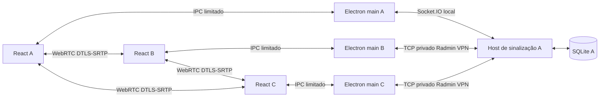

# Arquitetura do Voxy

## Atualização 0.2.0

O limite compartilhado passou para dez participantes (45 pares, até nove cópias por transmissor). Preferências de voz e transmissão são mapas persistidos por UUID no perfil local, sem enviar essas preferências ao host. O Push to Talk usa um helper Windows iniciado pelo main com tecla da lista permitida, consulta GetAsyncKeyState e monitora saída/heartbeat; o renderer recebe somente o estado da tecla escolhida. Falha/saída libera o estado e o gate permanece fechado em PTT. Mute manual tem prioridade. Sons são osciladores WebAudio na saída local, sem serem misturados ao envio do microfone.

Imagens são validadas por formato, tamanho e dimensões, gravadas em tabela separada relacionada à mensagem e recuperadas por solicitação autenticada. O snapshot carrega somente IDs, não base64. O limite do pacote Socket.IO passou para 3 MB para anexos de até 2 MB; limites de SDP/ICE continuam menores. O histórico antigo é mantido, com criação aditiva da tabela de imagens. O avatar 👴 é uma escolha normal de perfil, sem sobreposição.

Atualizações usam seleção nativa do instalador, staging privado, validação de versão/PE/hash e revisão explícita antes de executar. A configuração NSIS mantém appId e nome e não apaga userData. O main salva e faz backup antes de iniciar a instalação silenciosa e encerrar. Não há endpoint de download ou execução de comandos arbitrários enviados por clientes. Notas públicas são cadastradas por versão e as notas já vistas são registradas separadamente em userData. Veja o guia de atualização para as limitações de autenticidade de pacotes não assinados.

Os detalhes abaixo descrevem também a base das versões anteriores; onde houver limites antigos de participantes/pacote, valem os números da versão 0.2.0 acima.

## Processos e módulos

- `src/main/`: janela, segurança, seleção de captura, perfil/segredo, cliente Socket.IO e ciclo do host. Somente o main acessa disco/rede de sinalização. O main do host participa também como cliente local.
- `src/preload/`: contrato explícito `window.voxy`; nenhum IPC genérico, sistema de arquivos, execução de comandos ou API Node é exposto.
- `src/renderer/`: UI React, componentes de formulários/player/modais e controles reais. Fontes, ícones SVG e estilos são locais; sem assets do Discord.
- `src/services/signaling/host.ts`: validação, autorização, estado de participantes, CRUD e encaminhamento de SDP/ICE entre pessoas do mesmo canal.
- `src/services/webrtc/engine.ts`: uma `RTCPeerConnection` por par, captura, slots de mídia, análise RMS, players de áudio, métricas e limpeza.
- `src/database/store.ts`: SQLite via sql.js, queries parametrizadas e exportação atômica por arquivo temporário/rename. Chaves estrangeiras são reativadas após exportação do sql.js. Sem addons nativos de banco para empacotar; o WASM e dependências de runtime seguem no ASAR.
- `src/shared/`: tipos e schemas Zod usados nos limites IPC/rede.

## Entrada e estado

O main só permite hospedar em um IPv4 privado local, loopback ou um endereço 26/8 de adaptador local com Radmin no nome; nunca wildcard. A faixa 26/8 não é RFC1918 e só é oferecida para escuta nessa interface virtual específica. Endereços Radmin aparecem primeiro. Convites aceitam 26/8 para alcançar os amigos pela VPN. O convite contém IP, porta e segredo aleatório de 256 bits. A chave persistida do host usa `safeStorage` (DPAPI no Windows) e a operação é recusada se a proteção não estiver disponível. O segredo dos clientes só fica em memória.

Socket.IO roda exclusivamente sobre WebSocket, máximo de 80 KB por pacote recebido. O host rejeita origens de navegador; o cliente nativo no main não envia Origin. O segredo é comparado com `timingSafeEqual`. Cada sessão tem socket ID novo; o UUID de perfil é local e não é identidade criptográfica. A credencial de administração é uma segunda chave efêmera criada no main ao hospedar, nunca parte do convite. Só o host faz CRUD de servidores/canais. Participantes autorizados podem escrever nos canais de texto e entrar na voz. Limite de cinco pessoas, incluindo o host, centralizado em `MAX_PARTICIPANTS`; um mesmo UUID não pode entrar duas vezes.

Inputs têm limites de tamanho/tipo; nomes até 60 caracteres, mensagens até 4000, SDP até 64000 e candidate até 4000. Há orçamento de ações por socket (burst 120, reposição 60/s). O host sobrescreve o remetente de sinalização a partir da sessão autenticada. SDP/ICE só é encaminhado se ambos estiverem no mesmo canal de voz não nulo. O estado inclui nomes/mute/deafen/transmissão e histórico recente, sem segredos administrativos. O host é autoridade confiável, não um adversário isolado por criptografia ponta a ponta de identidade.

## Negociação e mídia

O participante com menor socket ID lexicográfico oferece; o outro responde. Somente o offerer cria os três transceivers `sendrecv`, na ordem fixa: microfone Opus (m-line 0), vídeo de tela com VP8 preferido (1), áudio do sistema (2). O answerer adota os transceivers recebidos ao aplicar SDP. Criá-los nos dois lados antecipadamente introduziria slots extras inativos; há teste garantindo exatamente três por par.

Operações de SDP/ICE são serializadas por par. Candidates ficam em fila até existir remote description. Sinais que chegam antes da criação do par ficam em um buffer pequeno. Descrições e candidates são convertidos com `toJSON()` antes do contextBridge/IPC; objetos DOM não são contratos IPC portáveis. Não há glare de ofertas porque a eleição é determinística. Falhas de conexão tentam ICE restart pelo offerer depois de quatro segundos; sem STUN/TURN externos, a recuperação depende do caminho privado existente.

Microfone é capturado ao entrar e anexado ao slot 0. Tela e áudio do sistema ocupam slots já negociados usando `replaceTrack`, incluindo `null` ao parar. Isso permite começar/recomeçar sem remover a track de voz ou renegociar toda a chamada. Quem entra enquanto há transmissão recebe as tracks atuais durante a preparação do par. Todos no canal recebem o vídeo enviado; a seleção de assistir controla player/áudio local, não uma assinatura dinâmica de largura de banda.

O main oferece miniaturas via `desktopCapturer`, valida a escolha e guarda uma seleção descartável por 30 segundos. O renderer chama `getDisplayMedia`; `setDisplayMediaRequestHandler` só atende o frame confiável e a fonte explicitamente escolhida. Não há permissão geral de captura nem seleção silenciosa. `onended` encerra o compartilhamento se o Chromium comunicar término da fonte ou controle nativo. Sair/desconectar fecha todos os PCs, timers, AudioContext, streams e tracks. Interrupções de captura que apenas congelem quadros, sem `ended`, dependem do comportamento do driver/Windows; há aviso de carregamento e diagnóstico, e o usuário pode parar manualmente.

Vídeo e áudio do sistema são reproduzidos separadamente: uma trilha de áudio sem pacotes não pode bloquear o player de vídeo. Voz fica em player próprio e continua sem a visualização. Áudio de sistema só é desmutado para a transmissão selecionada. Mute controla `track.enabled`; deafen controla a reprodução local. RMS com hold de 220 ms indica atividade real. Estatísticas são consultadas a cada dois segundos; FPS, dimensões e RTT podem não ser publicados pelo Chromium em todos os estados.

## Segurança e limites

`contextIsolation: true`, `nodeIntegration: false`, sandbox e webSecurity ativos. Preload compilado CJS compatível com renderer sandboxed. IPC só aceita o WebContents/frame principal e URL exata esperados. CSP restringe scripts, mídia, imagens e conexões; desenvolvimento admite somente o WebSocket local do Vite. Nenhuma janela externa/webview é aberta; navegações para URLs não confiáveis são bloqueadas. Permissões limitadas a áudio, captura aprovada, escolha de saída e fullscreen no documento confiável. Sem shell ou caminhos arbitrários recebidos pelo renderer. UI usa texto React, sem HTML injetado em mensagens.

A sinalização é HTTP/WebSocket privado, sem TLS próprio. Radmin VPN protege o transporte entre os dispositivos. Em LAN simples, um atacante com acesso ao tráfego pode comprometer o convite/sinalização: use Radmin VPN, não redes compartilhadas sem proteção. Mídia usa a criptografia WebRTC, mas não há verificação externa das fingerprints; um host comprometido é uma ameaça. Nome/avatar/status são autodeclarados. Não há escudo contra ataque volumétrico de um membro autorizado nem contra malware local.

Sem relay WebRTC, exposição pública, UPnP ou abertura automática de firewall. A conectividade depende do caminho disponibilizado pelo Radmin VPN; não se promete UDP físico direto universal. Com cinco pessoas, o mesh tem dez pares e cada transmissor envia até quatro cópias da tela. O buffer de sinalização antecipada comporta os quatro pares por participante. Reconexão Socket.IO tenta cinco vezes, mas voz e tela exigem entrada explícita depois da perda de sessão. Fechar o host encerra a sala, sem eleição de novo host.

SQLite e perfil ficam no disco do host/cliente respectivamente, não criptografados. Só o segredo persistente recebe DPAPI. O histórico inteiro cresce no SQLite; a UI carrega as últimas 500 mensagens por canal. Este banco em memória com exportação serve ao grupo pequeno, não a logs grandes ou múltiplos escritores. Backups devem ser feitos com a aplicação fechada.
