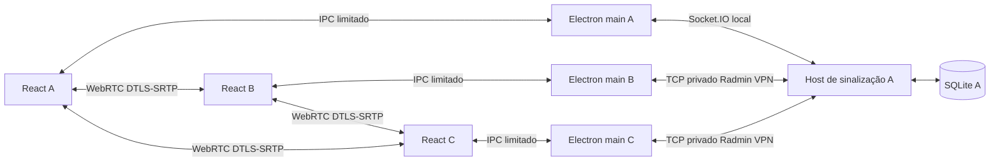

# Arquitetura do Voxy

## Navegação, presença e DMs — 0.5.0

`AppPage` separa Home, Novidades, sala e DMs. Toda seleção de canal define a página de sala; canais só recebem seleção ativa quando essa página está visível. `ServerRail` combina servidores atuais e salvos sem duplicar os conectados. Home e lateral usam uma única assinatura/polling em `useSavedRooms`, com refresh adicional quando o estado muda durante uma consulta. O ícone do servidor remove o padding do botão e aplica `object-fit: cover`, mantendo proporção e bordas.

`Profile.presence` aceita online/away/busy e migra perfis antigos para online. É salvo localmente e enviado no perfil público e nas atualizações do perfil. Offline é derivado da ausência do participante, sem alterar a preferência salva. A presença não modifica mute/deafen nem os slots de mídia.

`DirectStore` adiciona tabelas a SQLite: contatos, vínculos de identidade, mensagens privadas sequenciadas e imagens privadas. DMs não entram em `RoomState`, `messages` ou no endpoint público de imagens. O evento Socket.IO `direct` é montado por perfil; envios/edições/exclusões atualizam apenas remetente e destinatário. O endpoint `direct-image` verifica se o solicitante pertence ao par. Não há exceção de autoria para o host no protocolo de alteração de mensagens.

`profile-identity.bin` contém um segredo aleatório protegido por safeStorage/DPAPI. O main deriva uma credencial HMAC-SHA-256 por perfil e segredo da sala e a envia na autenticação pela rede privada. O host guarda apenas seu hash, vinculado ao UUID e ao hash da sala. Após o primeiro registro, uma conexão com o UUID mas sem essa credencial é recusada. O registro é TOFU: requer confiança no primeiro vínculo e no host. Não implementa identidade global nem E2EE. Clientes antigos sem vínculo podem usar funções anteriores, mas não recebem snapshots privados. A perda da identidade exige recuperação no mesmo Windows/usuário ou um novo perfil.

O protocolo de mídia continua 2, com quatro transceivers. Novos hosts anunciam `features` para presença/DMs; o cliente informa quando o host não oferece esses recursos. Comandos privados carregam o escopo derivado da sala, validado no main e no host, para impedir envio acidental à sala errada após trocar de conexão.

`DirectInbox` valida snapshots e mantém cópia local por escopo e perfil em `direct-inbox.json`. O escopo é um hash que não revela o convite. Guarda contatos/fotos, últimas mensagens e marcador monotônico de leitura por interlocutor; exclusões e edições substituem o snapshot da sala sem ressuscitar mensagens antigas. Cada conversa carrega até 500 mensagens, com teto de 5.000 por snapshot e 40 salas locais. O host preserva as mensagens anteriores no banco; não há paginação no renderer. Texto e thumbnails ficam disponíveis offline, enquanto anexos ainda precisam ser buscados no host.

`DirectConversation` reutiliza `Chat` para preservar imagens, edição/exclusão e aparência. A leitura só avança com a conversa aberta e a janela em foco. Mensagens novas produzem badge e aviso clicável; notificações Windows ocorrem em segundo plano. Ocupado suprime avisos, mas mantém contadores. Não há confirmação de leitura enviada ao outro usuário. Backups incluem identidade e cache privado. Privacidade e uso: [CONVERSAS-E-STATUS.md](CONVERSAS-E-STATUS.md).

## Atualização 0.4.0

O protocolo de sala passa a 2. Host valida o protocolo no handshake; cliente espera o primeiro snapshot com protocolo compatível antes de confirmar a conexão. Clientes/hosts antigos são rejeitados com orientação para atualizar, evitando misturar contratos de mídia.

Cada par negocia quatro transceivers `sendrecv`, na ordem fixa: microfone Opus (mid 0), tela (1), áudio do sistema (2) e webcam (3). O offerer cria os quatro; o answerer adota os recebidos. Webcam usa `getUserMedia({audio:false,video:...})`, com alvo 720p/30 e limite de 1,5 Mbps aplicado aos senders negociados ao iniciar. Tela e câmera ocupam slots independentes. Trocas usam `replaceTrack` com rollback para a câmera anterior se falhar. Parar, sair, desconectar e `ended` liberam as tracks, sem alterar o microfone. A geração da captura evita reutilizar uma câmera liberada em operações pendentes. O main autoriza captura de vídeo somente ao documento confiável, no canal de voz e após uma autorização explícita de 30 s via IPC. As permissões do Windows continuam necessárias. Referências: [permissões do Electron](https://www.electronjs.org/docs/latest/api/session) e [replaceTrack](https://developer.mozilla.org/en-US/docs/Web/API/RTCRtpSender/replaceTrack).

`VoiceView.cameraStreams` separa webcam dos streams de tela. A grade exibe câmeras ativas do mesmo canal; o player compartilhado mantém fullscreen/HUD e não reproduz áudio da webcam. A voz usa o microfone existente. Estatísticas têm contadores por SSRC, separados entre câmera e tela, para evitar bitrate negativo ao somar dois vídeos. Novos pares negociados enquanto a câmera está ativa recebem a track atual; FPS/resolução/bitrate reais dependem da negociação e do hardware. Em mesh, cada câmera é enviada a cada outro participante, mesmo sem player ampliado.

Servidores recebem `ownerId` e `icon` por migração aditiva. O primeiro host autenticado atribui seu UUID apenas aos registros legados sem dono; proprietários existentes não são sobrescritos. Só o proprietário pode mudar o ícone, validado no serviço e no Store. A imagem usa a mesma normalização de 128 px e deduplicação de avatares. A permissão é por UUID dentro do modelo privado de convite; a limitação de identidade autodeclarada descrita abaixo continua válida.

`RecentRooms` mantém até 40 acessos em `recent-rooms.json`. Metadados (nome, imagem, IP, porta, horário e ID do servidor) ficam legíveis; o convite completo é protegido via safeStorage/DPAPI. Renderer recebe somente metadados e um UUID local opaco para reconectar/remover. O main valida novamente IP, convite e ID. Metadados são atualizados quando os servidores mudam, sem gravar a cada evento de voz. Remover um recente conectado não o recria nos próximos snapshots; um novo acesso explícito pode salvá-lo de novo. JSON inválido é preservado como `.corrupt-*` antes de iniciar uma lista vazia. A migração não inventa convites antigos.

A disponibilidade usa POST `/availability` autenticado, limitado e com corpo máximo de 1 KB. Não cria socket participante, não ocupa vaga e informa disponível, sala cheia, convite inválido ou servidor removido; falha de transporte é apenas fora de alcance. Cliente limita consultas a quatro simultâneas, com timeout de 1,8 s. Sem interface Radmin detectável não consulta endereços 26/8. Home consulta ao abrir, focar, a cada 30 s e manualmente; pode continuar listando offline. Consultas não enviam convites ao renderer nem os registram em logs. O transporte continua dependendo da VPN, sem TLS próprio.

`ReleaseChannel` lê o catálogo empacotado por IPC, sem depender de host ou rede. Cada versão tem data, título, funcionalidades, melhorias e correções. As entradas de 0.2.0 e 0.3.0 permanecem no catálogo. O catálogo instalado é combinado com o último catálogo remoto verificado por assinatura Ed25519 e mantido em cache offline. O popup de primeira abertura continua independente do histórico, com sua marcação por versão. Backups incluem `recent-rooms.json` e `remote-release-history.json`.

## Atualização 0.3.0

O microfone passa por `MicrophonePipeline`: captura com cancelamento de eco, supressão de ruído e `autoGainControl: false` → medição RMS antes do ganho → volume manual → gate com limiar em dBFS → `MediaStreamAudioDestinationNode` → slot de microfone WebRTC. O gate usa 6 dB de histerese e retenção de 250 ms, com transições de ganho suavizadas. Mute e PTT continuam desabilitando a track enviada e têm prioridade; a captura bruta permanece ativa para a medição e é encerrada ao sair. O main desativa background throttling para a detecção continuar com a janela minimizada. Veja as referências de [autoGainControl](https://developer.mozilla.org/en-US/docs/Web/API/MediaTrackConstraints/autoGainControl) e [setTargetAtTime](https://developer.mozilla.org/en-US/docs/Web/API/AudioParam/setTargetAtTime).

O PTT captura `KeyboardEvent.code`, valida em um mapa de teclas Windows e envia somente o VK numérico permitido ao helper. Não executa texto recebido do renderer. A configuração antiga continua compatível. A API distingue teclas laterais quando o Windows oferece VK específico; Enter principal e numérico usam o mesmo VK. Fn e atalhos interceptados pelo sistema não são garantidos.

Edição/exclusão são comandos autenticados. O host confere autoria no banco pelo UUID do perfil antes de alterar; nem o host pode alterar a mensagem de outro perfil. A migração adiciona `editedAt` preservando mensagens e imagens, e exclusões removem imagens por chave estrangeira. A identidade ainda é a identidade local do modelo de convite: quem possui o segredo e copia o UUID de outro perfil pode se passar por ele quando ele estiver desconectado; não existe conta com senha/assinatura individual.

O som de transmissão usa transição `sharing: false → true` dos participantes do mesmo canal, incluindo o próprio usuário. Snapshots repetidos não repetem o som. Não toca por transmissões de outros canais, ao entrar em uma transmissão já ativa, com sons desativados ou deafen. Reiniciar uma transmissão gera um novo aviso.

Mute local usa `mutedParticipants`, um mapa de UUID → boolean salvo via IPC específico e validado. O engine aplica `audio.muted = deafened || mutedParticipants[profileId]` apenas à voz, preserva o volume configurado e mantém o mute após trocar socket/reentrar. Deafen não remove a preferência. Esse estado não é transmitido ao host nem altera os outros clientes. `ParticipantStatus` apresenta separadamente microfone, deafen compartilhado e mute local.

Fotos são decodificadas e recortadas no renderer a partir de PNG/JPEG/WebP locais até 5 MB, 8192 px e 24 MP. A saída WebP de 128×128 até 32 KB é validada novamente no main e no host por MIME, cabeçalho, dimensões e tamanho; SVG/URLs externas não são aceitos como foto. O perfil local guarda a miniatura. No host, a tabela `avatars` deduplica por SHA-256: participantes e mensagens guardam `avatar:<hash>`, e o snapshot traz uma cópia de cada miniatura referenciada no mapa `avatars`. O contexto `AvatarImages` resolve a imagem em toda a interface. O histórico mantém a foto usada no envio; emojis antigos continuam compatíveis. Miniaturas antigas permanecem no banco enquanto não houver limpeza manual dos dados; não há envio do arquivo original ou caminho local.

## Atualização 0.2.0

O limite compartilhado passou para dez participantes (45 pares, até nove cópias por transmissor). Preferências de voz e transmissão são mapas persistidos por UUID no perfil local, sem enviar essas preferências ao host. O Push to Talk usa um helper Windows iniciado pelo main com tecla da lista permitida, consulta GetAsyncKeyState e monitora saída/heartbeat; o renderer recebe somente o estado da tecla escolhida. Falha/saída libera o estado e o gate permanece fechado em PTT. Mute manual tem prioridade. Sons são osciladores WebAudio na saída local, sem serem misturados ao envio do microfone.

Imagens são validadas por formato, tamanho e dimensões, gravadas em tabela separada relacionada à mensagem e recuperadas por solicitação autenticada. O snapshot carrega somente IDs, não base64. O limite do pacote Socket.IO passou para 3 MB para anexos de até 2 MB; limites de SDP/ICE continuam menores. O histórico antigo é mantido, com criação aditiva da tabela de imagens. O avatar 👴 é uma escolha normal de perfil, sem sobreposição.

Atualizações usam seleção nativa do instalador, staging privado, validação de versão/PE/hash e revisão explícita antes de executar. A configuração NSIS mantém appId e nome e não apaga userData. O main salva e faz backup antes de iniciar a instalação silenciosa e encerrar. O fluxo remoto usa endpoint HTTPS fixo, assinatura Ed25519 e downloads do GitHub Releases, sem execução de comandos enviados por clientes. Notas públicas são cadastradas por versão e as notas já vistas são registradas separadamente em userData. Veja o guia de atualização para as limitações de autenticidade de pacotes não assinados.

Os detalhes abaixo descrevem também a base das versões anteriores; onde houver limites antigos de participantes/pacote, valem os números da versão 0.2.0 acima.

## Processos e módulos

- `src/main/`: janela, segurança, seleção de captura, perfil/segredo, cliente Socket.IO e ciclo do host. Somente o main acessa disco/rede de sinalização. O main do host participa também como cliente local.
- `src/preload/`: contrato explícito `window.voxy`; nenhum IPC genérico, sistema de arquivos, execução de comandos ou API Node é exposto.
- `src/renderer/`: UI React, componentes de formulários/player/modais e controles reais. Fontes, ícones SVG e estilos são locais; sem assets do Discord.
- `src/services/signaling/host.ts`: validação, autorização, estado de participantes, CRUD e encaminhamento de SDP/ICE entre pessoas do mesmo canal.
- `src/services/webrtc/engine.ts`: uma `RTCPeerConnection` por par, captura, slots de mídia, análise RMS, players de áudio, métricas e limpeza.
- `src/database/store.ts`: SQLite via sql.js, queries parametrizadas e exportação atômica por arquivo temporário/rename. Chaves estrangeiras são reativadas após exportação do sql.js. Sem addons nativos de banco para empacotar; o WASM e dependências de runtime seguem no ASAR.
- `src/shared/`: tipos e schemas Zod usados nos limites IPC/rede.

## Entrada e estado

O main só permite hospedar em um IPv4 privado local, loopback ou um endereço 26/8 de adaptador local com Radmin no nome; nunca wildcard. A faixa 26/8 não é RFC1918 e só é oferecida para escuta nessa interface virtual específica. Endereços Radmin aparecem primeiro. Convites aceitam 26/8 para alcançar os amigos pela VPN. O convite contém IP, porta e segredo aleatório de 256 bits. A chave persistida do host usa `safeStorage` (DPAPI no Windows) e a operação é recusada se a proteção não estiver disponível. O segredo dos clientes só fica em memória.

Socket.IO roda exclusivamente sobre WebSocket, máximo de 80 KB por pacote recebido. O host rejeita origens de navegador; o cliente nativo no main não envia Origin. O segredo é comparado com `timingSafeEqual`. Cada sessão tem socket ID novo; o UUID de perfil é local e não é identidade criptográfica. A credencial de administração é uma segunda chave efêmera criada no main ao hospedar, nunca parte do convite. Só o host faz CRUD de servidores/canais. Participantes autorizados podem escrever nos canais de texto e entrar na voz. Limite de cinco pessoas, incluindo o host, centralizado em `MAX_PARTICIPANTS`; um mesmo UUID não pode entrar duas vezes.

Inputs têm limites de tamanho/tipo; nomes até 60 caracteres, mensagens até 4000, SDP até 64000 e candidate até 4000. Há orçamento de ações por socket (burst 120, reposição 60/s). O host sobrescreve o remetente de sinalização a partir da sessão autenticada. SDP/ICE só é encaminhado se ambos estiverem no mesmo canal de voz não nulo. O estado inclui nomes/mute/deafen/transmissão e histórico recente, sem segredos administrativos. O host é autoridade confiável, não um adversário isolado por criptografia ponta a ponta de identidade.

## Negociação e mídia

O participante com menor socket ID lexicográfico oferece; o outro responde. Somente o offerer cria os três transceivers `sendrecv`, na ordem fixa: microfone Opus (m-line 0), vídeo de tela com VP8 preferido (1), áudio do sistema (2). O answerer adota os transceivers recebidos ao aplicar SDP. Criá-los nos dois lados antecipadamente introduziria slots extras inativos; há teste garantindo exatamente três por par.

Operações de SDP/ICE são serializadas por par. Candidates ficam em fila até existir remote description. Sinais que chegam antes da criação do par ficam em um buffer pequeno. Descrições e candidates são convertidos com `toJSON()` antes do contextBridge/IPC; objetos DOM não são contratos IPC portáveis. Não há glare de ofertas porque a eleição é determinística. Falhas de conexão tentam ICE restart pelo offerer depois de quatro segundos; sem STUN/TURN externos, a recuperação depende do caminho privado existente.

Microfone é capturado ao entrar e anexado ao slot 0. Tela e áudio do sistema ocupam slots já negociados usando `replaceTrack`, incluindo `null` ao parar. Isso permite começar/recomeçar sem remover a track de voz ou renegociar toda a chamada. Quem entra enquanto há transmissão recebe as tracks atuais durante a preparação do par. Todos no canal recebem o vídeo enviado; a seleção de assistir controla player/áudio local, não uma assinatura dinâmica de largura de banda.

O main oferece miniaturas via `desktopCapturer`, valida a escolha e guarda uma seleção descartável por 30 segundos. O renderer chama `getDisplayMedia`; `setDisplayMediaRequestHandler` só atende o frame confiável e a fonte explicitamente escolhida. Não há permissão geral de captura nem seleção silenciosa. `onended` encerra o compartilhamento se o Chromium comunicar término da fonte ou controle nativo. Sair/desconectar fecha todos os PCs, timers, AudioContext, streams e tracks. Interrupções de captura que apenas congelem quadros, sem `ended`, dependem do comportamento do driver/Windows; há aviso de carregamento e diagnóstico, e o usuário pode parar manualmente.

Vídeo e áudio do sistema são reproduzidos separadamente: uma trilha de áudio sem pacotes não pode bloquear o player de vídeo. Voz fica em player próprio e continua sem a visualização. Áudio de sistema só é desmutado para a transmissão selecionada. Mute controla `track.enabled`; deafen controla a reprodução local. RMS com hold de 220 ms indica atividade real. Estatísticas são consultadas a cada dois segundos; FPS, dimensões e RTT podem não ser publicados pelo Chromium em todos os estados.

## Segurança e limites

`contextIsolation: true`, `nodeIntegration: false`, sandbox e webSecurity ativos. Preload compilado CJS compatível com renderer sandboxed. IPC só aceita o WebContents/frame principal e URL exata esperados. CSP restringe scripts, mídia, imagens e conexões; desenvolvimento admite somente o WebSocket local do Vite. Nenhuma janela externa/webview é aberta; navegações para URLs não confiáveis são bloqueadas. Permissões limitadas a áudio, captura aprovada, escolha de saída e fullscreen no documento confiável. Sem shell ou caminhos arbitrários recebidos pelo renderer. UI usa texto React, sem HTML injetado em mensagens.

A sinalização é HTTP/WebSocket privado, sem TLS próprio. Radmin VPN protege o transporte entre os dispositivos. Em LAN simples, um atacante com acesso ao tráfego pode comprometer o convite/sinalização: use Radmin VPN, não redes compartilhadas sem proteção. Mídia usa a criptografia WebRTC, mas não há verificação externa das fingerprints; um host comprometido é uma ameaça. Nome/avatar/status são autodeclarados. Não há escudo contra ataque volumétrico de um membro autorizado nem contra malware local.

Sem relay WebRTC, exposição pública, UPnP ou abertura automática de firewall. A conectividade depende do caminho disponibilizado pelo Radmin VPN; não se promete UDP físico direto universal. Com dez pessoas, o mesh tem 45 pares e cada transmissor envia até nove cópias de cada vídeo. O buffer de sinalização antecipada comporta os pares por participante. Reconexão Socket.IO tenta cinco vezes, mas voz e tela exigem entrada explícita depois da perda de sessão. Fechar o host encerra a sala, sem eleição de novo host.

SQLite e perfil ficam no disco do host/cliente respectivamente, não criptografados. Só o segredo persistente recebe DPAPI. O histórico inteiro cresce no SQLite; a UI carrega as últimas 500 mensagens por canal. Este banco em memória com exportação serve ao grupo pequeno, não a logs grandes ou múltiplos escritores. Backups devem ser feitos com a aplicação fechada.

## Distribuição remota

`RemoteUpdates` coordena o `NsisUpdater` do electron-updater 6.8.9. Consulta o envelope assinado no domínio devbarros.com (Vercel), valida Ed25519 com chaves públicas empacotadas e fixa versão/nomes/tamanhos/SHA-512 do manifesto e pacote. Os binários vêm da tag imutável no GitHub; o domínio tem fallback de consulta no GitHub. Downloads diferenciais usam blockmaps e cache do NSIS, com fallback completo. O hook oficial verifica o pacote, que é conferido novamente depois do download e antes da instalação. Authenticode é adicional quando configurado; o pacote atual não tem certificado Windows.

O main consulta após dez segundos e a cada seis horas em produção, mostra estado por IPC e não permite URLs arbitrárias do renderer. Download é automático; instalação e reinício são explícitos, após backup e encerramento da chamada. Falhas de download preservam o programa atual; não existe rollback automático de instalação NSIS interrompida. O workflow de tag gera todos os assets em draft e só depois publica latest. Detalhes de confiança, recuperação e implantação em [ATUALIZACOES-REMOTAS.md](ATUALIZACOES-REMOTAS.md).
