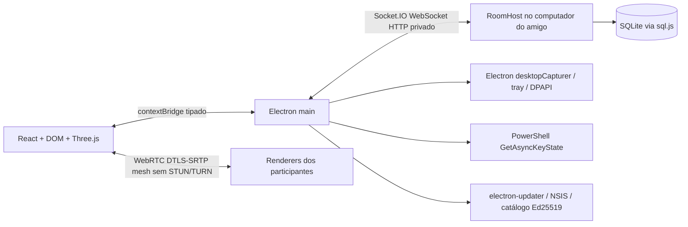

# Auditoria arquitetural da base 1.4.1

## Evolução após a auditoria

O inventário abaixo descreve a base **1.4.1** no commit original, não o estado completo do código nativo atual. Implementação incremental em native/, infraestrutura local em infra/signaling e nova direção visual estão detalhadas em [PROGRESS.md](PROGRESS.md), [ARCHITECTURE.md](ARCHITECTURE.md) e [native/DESIGN.md](native/DESIGN.md). Electron/Radmin continuam preservados no legado; os executáveis Rust não dependem deles. A auditoria não foi substituída por uma reescrita indiscriminada e nenhuma funcionalidade 3D/jogo foi removida da base estável.

Data: 2026-11-16. Base: `7df27bc684c0743fa52e12bfe6aae5073dd02371`. Estado estável preservado. O [índice de 234 arquivos](evidence/native-2.0-phase0/source-inventory.json) cobre fontes, assets, testes, scripts, build, workflow e guias rastreados, com SHA-256, imports, exports, handlers IPC, tabelas e referências a Radmin. Não inclui `node_modules`, binários gerados nem dados pessoais. É cobertura estática; não é prova de correção linha a linha. Os testes existentes e os executados nesta sessão são separados em PROGRESS.

## Fluxo atual e acoplamentos

- `src/main/index.ts` concentra ciclo de janela/host, perfil, cliente Socket.IO, IPC, seleção de captura, permissões, atalhos, notificações, PiP e coordenação do updater. É o maior ponto de separação da migração; não deve ser traduzido como monólito Rust.
- `src/preload/index.ts` implementa a API explícita `window.voxy` com respostas `Reply`, eventos e assinaturas removíveis. `src/shared/types.ts` é o contrato público; `validation.ts` contém validação Zod para perfis, comandos, mídia, convites e histórico.
- `src/renderer/App.tsx` coordena navegação, conexão/intenção de voz, diálogos e engine. Componentes em `components/` cobrem Home, trilho, chat, DMs, amigos, perfis, notificações, configurações/admin, galeria/player, releases e captura. `hooks/` mantém recentes, inbox, histórico e avisos.
- `src/services/signaling/host.ts` não é apenas sinalização: é autoridade de sala, persistência, autorização e encaminhamento de mensagens, arquivos de imagem, presença, canais, cargos, chamadas privadas, movimento, TV e jogos. `gameRoom.ts` coordena Truco/xadrez; sinuca usa simulação no host.
- `src/services/webrtc/engine.ts` mantém PeerConnections, quatro transceivers, subscriptions de mídia, captura, reprodução, medição e cleanup dentro do renderer. Núcleo de voz atual **não é independente da GUI/Chromium**.

## Rede, Radmin e segurança atual

Protocolo de sala **2**, até **10 participantes** (`constants.ts`), handshake de versão e confirmação do primeiro estado. Socket.IO usa WebSocket; conexão 8 s, cinco reconexões com atraso 1,5–6 s. Host possui segredo de convite de 256 bits e chave administrativa efêmera separada. O segredo persistente usa safeStorage/DPAPI. O host valida schemas, autoria, canal, escopo e pares de sinalização; orçamento de comandos burst 120/reposição 60/s, sinalização separado 512/128/s.

Convite atual: `voxy://IPv4:porta/segredo`. `addresses.ts` prioriza adaptador cujo nome contém Radmin e IP 26/8; `validation.ts` aceita privados, loopback, CGNAT 100.64/10 e 26/8. Host não escuta em wildcard nem IPv6. Home evita sondar 26/8 sem adaptador Radmin e consulta disponibilidade autenticada por HTTP. `host.ts` também impõe endereço privado ao iniciar. Sem DNS de descoberta, ICE servers ou TURN; `engine.ts:366` usa `iceServers: []`.

Não há SDK/driver Radmin no package.json. A dependência é operacional e espalhada: adaptador/convite/bind/sondagem, HTTP sem TLS próprio, candidatos privados, textos de erro/reconexão, testes `callNetwork.e2e.ts` e guias de instalação/áudio. `radminLines` no índice identifica referências textuais, mas **a dependência indireta inclui todos os recursos transportados pelo host**, mesmo sem a palavra Radmin. Instalar um STUN sem substituir esse transporte deixaria chat/admin/jogos inacessíveis.

Mídia tem DTLS-SRTP; identidade local é UUID com vínculo TOFU por credencial HMAC derivada do segredo DPAPI e da sala (`deviceIdentity.ts`, `database/direct.ts`). Não é conta global nem autenticação pública robusta. O host lê mensagens/DMs; não existe E2EE de mensagens contra o host. Primeiro vínculo e administração exigem confiança. Cargos têm nome/cor/ordem; permissões estão reservadas e o proprietário efetua a administração. Não afirmar RBAC completo.

**Não expor o host HTTP atual à internet.** Novo protocolo exige autenticação criptográfica, proteção contra replay, limites de pré-autenticação, autorização por recurso e ligação da identidade ao canal de mídia. A falha “servidor conecta mas chamada não entra” deve continuar distinguindo plano de controle, abertura de dispositivos, confirmação e ICE; não foi provada resolvida em todos os PCs afetados na 1.4.1.

## Voz e multimídia

Quatro slots fixos por par: mic, tela, áudio de tela, webcam. Só o offerer eleito cria transceivers; answerer os adota. Fila serializa SDP/ICE e retém candidatos anteriores à descrição. Troca de tracks usa `replaceTrack`; subscriptions permitem suprimir envio de vídeo não solicitado nos clientes compatíveis. Em até dez pessoas podem existir 45 pares; cada transmissor tem até nove destinos. Reconexão ICE inicia após 4 s; não resolve ausência de rota.

`microphone.ts`: captura mono com AEC/NS/AGC habilitados por padrão no código atual, medição antes do ganho, gate com histerese 6 dB/retenção 250 ms, rampas e limiter. Algumas seções históricas de ARCHITECTURE descrevem AGC antigo desativado; a fonte atual e testes prevalecem. Teste privado usa pipeline/contexto próprios. `voicePlayback.ts` aplica ganho até 2×, atenuação e panorama estéreo e limiter por participante; saída preservada via elemento de áudio. Mute, deafen, PTT e preferência individual são independentes de áudio de tela.

`callDiagnostics.ts` registra etapas com dados redigidos; engine tem timeout de negociação 20 s. Entrada tem captura 12 s, contexto/saída 5 s, confirmação e geração/cancelamento; resultados tardios são descartados. Testes `callRecovery`, `microphone`, `audio`, `voiceControls`, `pushToTalk` e `callNetwork` são oráculos de regressão, não homologação física.

Captura usa `desktopCapturer` + permissões/seleção descartável de 30 s no main e `getDisplayMedia` no renderer. `capture.ts` solicita `restrictOwnAudio`; exige Windows build ≥20348/Electron ≥44 para captura segura. A seleção de janela limita vídeo; o som pode incluir outros processos, exceto o Voxy. Não existe isolamento garantido do processo selecionado. Webcam é track independente, alvo 720p/30 e orçamento próprio. Galeria, fullscreen/HUD, PiP e TV usam players e texturas de vídeo do navegador. Codecs, DSP, jitter, dispositivos, encode/decode e aceleração hoje são em grande parte entregues pelo Chromium e precisam substituto explícito.

## UI e Windows

React 19, CSS local, Lucide, Segoe UI e design system de ardósia/azul mineral. Temas Voxy/Oceano/Bosque/Kuromi, acento/nickname/capa, hub de configurações com rascunho e desfazer, administração por seções, layout mínimo 900×640, foco/teclado e movimento reduzido. Fontes e créditos: DESIGN-SYSTEM e componentes. React/CSS/DOM não serão reaproveitados como runtime; paleta, medidas, navegação e evidências visuais são especificação.

Electron fornece BrowserWindow, barra integrada, tray/menu, notificações, login automático, clipboard, shell, desktopCapturer, permissões, safeStorage, fullscreen, PiP e seleção de arquivos. `pushToTalk.ts` cria helpers PowerShell ocultos, com allowlist de VK, heartbeat e gate fechado ao falhar; contempla teclado e Mouse 4/5 e os atalhos de mute/deafen. Seu custo precisa entrar nas medições de PTT. Substituir por integração Win32 dentro do núcleo nativo. Identidade instalada `dev.voxy.desktop`, dados `%APPDATA%/voxy-desktop`; desenvolvimento usa nome/appId/pasta distintos.

## Mundo 3D, avatares e jogos

`room3d/scene.ts` coordena Three.js/WebGL2, câmera, movimento, recursos, streaming da TV, jogos e áudio espacial. `environment.ts` e `Rooftop.ts` constroem Lounge/Cinema/Rooftop. `avatar.ts`, `characterGeometry.ts`, `ArmIK.ts` geram geometria articulada, cabelo/roupas/rosto/IK; os personagens GLB da 1.1 estão arquivados e **não são o avatar atual**. Móveis também têm reconstruções procedurais. `assets.ts` carrega decoração GLB e descarta resultados tardios; `resources.ts` acompanha geometria/material/textura e faz dispose. UI faz lazy load do mundo/editor, pausa oculto e libera ao sair, mas o runtime Chromium permanece.

Acervo: nove móveis, cinco personagens arquivados e textura, manifest SHA-256 e licenças CC0. Geometrias, texturas Canvas, cartas, animações, skyline e iluminação autorais estão no código. Copiar somente assets binários perderia parte substancial da experiência. ASSETS-3D e SALAS-3D são referências, não autorização para simplificar cenários.

Sinuca: regra **Rotação 7** própria, física fixed step 1/120 s no host, doze passos por tick de 100 ms quando necessário, revisão/turno/faltas/bola na mão, timing de contato, IK/taco, mira fixa e espectadores. Truco: baralho 40 cartas, pares opostos, manilha variável, aumentos até 12, onze/ferro, decisões por parceiro e snapshots privados. Xadrez: `chess.js` + wrapper autoritativo com roque/en passant/promoção/empates/reivindicações e animação. `GameSeats` reserva Truco/xadrez por 60 s; sinuca termina com desconexão. Partidas são voláteis, sem promessa de retomada após host reiniciar. Clientes não são árbitros. Portar regras e apresentação separadamente, com fixtures diferenciais e RNG/relógio controlados.

## Persistência e migração a planejar

| Origem 1.x | Conteúdo | Tratamento nativo proposto |
| --- | --- | --- |
| `profile.json` | UUID, nome, foto/emoji, avatar3d atual, temas/capa, atalhos, áudio, volumes, mute local, notificações, Windows e 3D | Validar todos os campos, preservar desconhecidos em backup, mapear IDs de dispositivos por capacidade e pedir nova escolha se não reconhecidos. Os seis visuais do editor exigem o localStorage abaixo. |
| `room.sqlite` | `servers`, `channels`, `messages`, `images`, `avatars`, `roles`, `member_roles`, `public_profiles`, `reactions`, `friendships`, `direct_contacts`, `profile_auth`, `direct_messages`, `direct_images`, `direct_reactions` | Abrir cópia com SQLite nativo em leitura; integridade/FKs/contagens, transação no destino e hashes dos anexos. Não converter original nem inventar dados de mensagens que só existem no host. |
| `profile-identity.bin`, `host-secret.bin` | Identidade local e segredo host, envelopes Electron safeStorage/DPAPI | Verificar compatibilidade do envelope e contexto Windows. UUID preservado não basta para credenciais. Conservar vínculo legado por sala até migração autenticada para chave pública. |
| `recent-rooms.json` | Até 40 recentes, convite protegido, nome/imagem/IP/porta/horário | Preservar lista; convite VPN não vira convite público automaticamente. Host deve registrar a sala nova e emitir novo convite. |
| `direct-inbox.json` | Cache por perfil/sala, contatos, últimas mensagens, leitura | Preservar escopos antigos e associação, sem misturar conversas de salas distintas nem ressuscitar exclusões. Anexos não cacheados continuam exigindo host. |
| `notifications.json` | Histórico, deduplicação e leitura | Importação por perfil, preservando configurações e sem reemitir alertas antigos. |
| `release-notes.json`, `remote-release-history.json` | Versões vistas e catálogo remoto verificado/cache | Migrar marcações e verificar novamente assinaturas; não tratar JSON de cache como confiança por si só. |
| Chromium Local Storage (`AvatarCreator.tsx`) | Visuais salvos: `voxy-avatar-presets-v1` | Exige exportação validada/compatível do LevelDB ou ponte controlada 1.x; copiar apenas profile.json perde os seis visuais. Nunca abrir LevelDB original simultaneamente à 1.x. |
| `backups/`, logs e cache de updates | Backups existentes, diagnósticos/cache recuperável | Preservar backups; não importar logs/instaladores como estado de usuário; não registrar segredos em inventário de migração. |

Procedimento ainda não implementado: fechar 1.x para snapshot consistente; copiar para diretório privado de staging; gerar manifesto de integridade sem conteúdo sensível; validar/importar em transação; comparar IDs, contagens e anexos; gravar recibo/versionamento só após sucesso. Testar arquivo corrompido, falta de espaço, lock, interrupção e repetição idempotente. Rollback experimental é voltar à 1.x intocada, sem copiar estado novo sobre o antigo. DPAPI pode impedir migração entre usuários/máquinas; informar limite em vez de regenerar identidade silenciosamente.

## Distribuição e dependências

`package.json` inclui React/ReactDOM, Socket.IO cliente/host, sql.js, Zod, lucide-react, chess.js e electron-updater. Electron 44.9.0 e Three são dependências de build, mas suas funções integram o executável. Vite/esbuild/TypeScript/tsx/Playwright/electron-builder/NSIS são ferramentas. A árvore exata está travada em package-lock; o índice registra imports diretos. Não foi feita auditoria CVE/licença de cada dependência transitiva; será exigido SBOM também na stack Rust.

`remoteUpdates.ts`, `updateTrust.ts`, `updateTransport.ts` e scripts validam catálogo Ed25519, versões, allowlist de URLs, tamanhos e hashes; `electron-updater` instala NSIS. Workflow `.github/workflows/release.yml` testa, valida tag, gera instalador/catálogo, testa pacote e publica somente depois; não sobrescreve estável. Chaves privadas só nos segredos de release. Atualização tem backup e reinício explícito, mas não rollback transacional automático de instalação interrompida. Reaproveitar protocolo de confiança/keys e testes, reconstruir executor/download/instalação em Rust. Authenticode é opcional e não comprovar assinatura Windows inexistente.

## Reaproveitamento

| Classe | Reaproveitar | Adaptar / reconstruir |
| --- | --- | --- |
| Especificações | Guias, tokens visuais, capturas, regras, contratos e fixtures | Rever informações históricas divergentes antes de portar. |
| Dados/assets | SQLite padrão, JSON validados, GLB/texturas/licenças existentes | DPAPI/LevelDB, geometria procedural, materiais/rigs/TV e privacidade por espectador. |
| Regras puras | Algoritmos de Truco, sinuca, navegação, movimento e assentos como referência | Tradução Rust + comparação; chess.js exige biblioteca nativa com política equivalente de empates. |
| Desktop/rede/mídia | Semântica e testes | Electron/IPC/DOM/WebAudio/Three/Socket.IO/PowerShell/electron-updater não entram no produto final; reimplementar em bibliotecas nativas. |

Pendências de auditoria profunda: fuzzing de parsers, revisão criptográfica do novo protocolo, CVEs/avisos transitivos, recuperação DPAPI/LevelDB, perfis reais anonimizados e paridade visual/física. Nenhuma substituição do produto foi iniciada antes dessas decisões.

## Integração pública — 17/11/2026

Sinalização Cloudflare implantada; endpoint/STUN padrão, canais/DMs/recentes integrados. [Estado e testes atuais](PROGRESS.md), [operação e limites](INFRASTRUCTURE.md), [homologação](native/PUBLIC-TESTING.md). Renderer/captura/codecs/regras existentes preservados; mundo/mídia completos ainda abertos. Sem publicação do aplicativo ou polimento estético.
