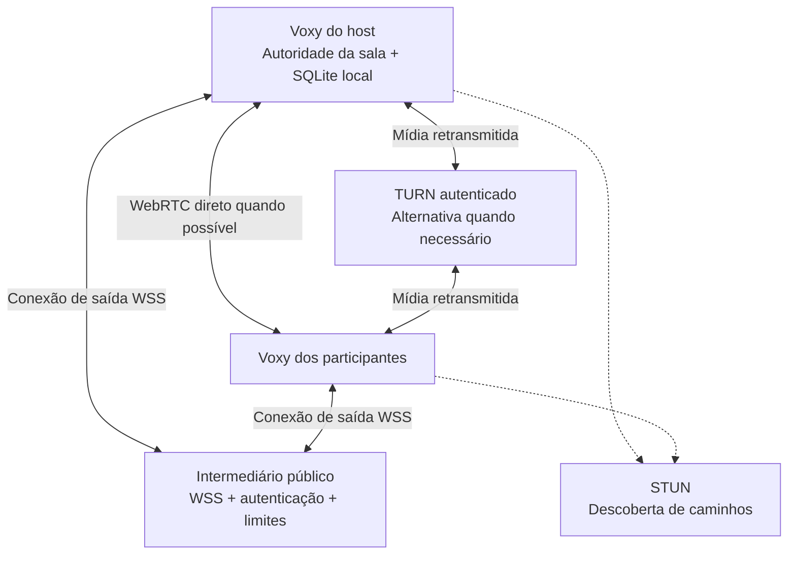

# Plano do Voxy 1.0

**Data da pesquisa:** 25/10/2026.<br />
**Estado:** planejamento; funcionalidades propostas ainda não implementadas.<br />
**Base:** 0.8.0 publicada e correções locais em preparação na 0.8.1.<br />
**Restrição:** não executar testes, contratar serviços, criar contas, fazer deploy ou publicar durante este planejamento. As verificações abaixo são critérios futuros, sujeitos à retomada autorizada.

## 1. Objetivo da versão

Entregar um Voxy confiável para Windows: instalar, abrir, entrar numa sala, conversar, compartilhar tela, recuperar uma conexão e atualizar sem perder dados ou precisar de ajuda técnica.

**Objetivo adicional desejado:** conexão pela internet sem VPN, inicialmente para grupos pequenos, buscando gasto financeiro zero dentro de cotas verificadas. Manter LAN/Radmin como alternativa.

A próxima publicação pode ser 1.0.0, incorporando a correção local preparada como 0.8.1. Isso não muda a versão do projeto agora nem autoriza publicação. A decisão final depende dos critérios deste documento.

## 2. Decisão recomendada

1. Fechar instalação, abertura, proteção dos dados e recuperação de falhas.
2. Implementar uma prova de conceito de internet: intermediário de sinalização acessível por WSS, STUN e TURN autenticado como alternativa à conexão direta.
3. Medir viabilidade técnica e consumo antes de anunciar funcionamento gratuito.
4. Se conectividade, segurança e orçamento forem aprovados, incluir o modo Internet na 1.0. Caso contrário, manter esse modo experimental ou adiá-lo; não remover a alternativa privada já existente.

**Caminho preferido para investigar:** Cloudflare Workers Free + Durable Objects com SQLite para coordenação das salas, com WebRTC direto e Cloudflare TURN quando necessário. **Alternativa estudantil:** uma pequena VM Linux no Azure for Students para o intermediário, eventualmente com coturn, respeitando créditos e limites.

Essa é uma escolha de arquitetura proposta, não uma confirmação de gratuidade da conta do usuário. Não existe garantia de retransmissão ilimitada, para qualquer rede e volume de vídeo, sem alguém arcar com infraestrutura.

## 3. O que já existe e pode ser aproveitado

| Área | Base atual | Trabalho para a 1.0 |
| --- | --- | --- |
| Áudio e vídeo | WebRTC mesh, microfone, tela, câmera, volumes, mute/Deafen e PTT | Confiabilidade, diagnóstico e comportamento em redes reais |
| Comunicação | Socket.IO com host local e contratos de mensagens/sinalização | Adaptador para transporte público sem abrir a porta do computador |
| Dados | SQLite no host, identidade local e caches privados | Recuperação, retenção de backups e gravação com impacto previsível |
| Interface | Perfis, temas, amigos, chat, notificações, PiP e bandeja | Primeiro uso guiado e mensagens claras de falha |
| Distribuição | NSIS, atualização com metadados assinados e smoke test do pacote | Verificar o caminho de instalação/atualização completo e os atalhos |
| Correção local | Nome/ícone/atalhos e abertura manual preparados na 0.8.1 | Incorporar à próxima versão e concluir os critérios de instalação |

Referências de código: [engine WebRTC](src/services/webrtc/engine.ts), [host](src/services/signaling/host.ts), [main](src/main/index.ts), [persistência](src/database/store.ts), [atualizador](src/main/remoteUpdates.ts) e [identidade Windows](src/main/desktopIdentity.ts).

## 4. Obrigatórios para considerar a versão estável

### P0 — Instalar, atualizar e abrir corretamente

- Nome Voxy no executável, janela, Menu Iniciar e aplicativos instalados; ícone correto nos atalhos e na barra de tarefas.
- Atalhos com alvo correto, argumentos corretos e identificação Windows explícita.
- Atualização deve restaurar a entrada do Menu Iniciar quando estiver ausente ou inválida.
- Abrir manualmente deve mostrar a janela; início oculto só na inicialização minimizada apropriada.
- Segunda abertura deve restaurar a instância já existente.
- Desenvolvimento deve ter identidade e dados separados da instalação de uso diário.
- Preservar perfil, UUID, identidades protegidas, salas, mensagens e preferências ao atualizar.
- Diferenciar assinatura dos metadados de atualização de assinatura Authenticode do executável. A primeira já existe; a segunda é uma decisão adicional de distribuição.

**Critério futuro:** instalação limpa e atualização da 0.8.0 em Windows de avaliação, incluindo abertura pelo Menu Iniciar, pela pesquisa e pelo atalho, bandeja, reinício e dados preservados. Abrir somente o executável empacotado não cobre esse fluxo inteiro.

### P0 — Não substituir silenciosamente o perfil quando houver erro

O tratamento atual de falha ao ler/validar `profile.json` pode criar um perfil novo e gravá-lo no lugar do anterior. Precisamos distinguir primeira execução, arquivo inválido, falha de disco e migração incompatível.

- Preservar o arquivo anterior e sua identidade antes de qualquer reparo.
- Tentar recuperação de uma cópia válida, quando disponível.
- Informar o problema e oferecer caminhos de recuperação.
- Não substituir UUID/credencial automaticamente por causa de falha de leitura.
- Tratar banco inválido ou indisponível com uma tela compreensível; evitar um aplicativo aparentemente aberto, mas sem janela utilizável.

**Critério futuro:** nenhum cenário de arquivo inválido deve sobrescrever a única cópia dos dados sem uma recuperação explícita.

### P0 — Voz e compartilhamento confiáveis no uso diário

- Microfone audível e estável com dispositivos físicos diferentes, incluindo USB e Bluetooth quando disponíveis.
- Trocar, desconectar e reconectar microfone/saída durante a chamada sem deixar estados presos.
- Mute, Deafen e PTT devem manter prioridade e restaurar corretamente os estados anteriores.
- Confirmar ausência de retorno digital da chamada no compartilhamento; manter a alternativa segura de vídeo sem áudio quando necessário.
- Verificar chamadas prolongadas, jogos, suspensão/retorno do Windows, troca de rede e encerramento do host.
- Preservar PiP, volumes e regras de assinatura de vídeo em segundo plano.

**Critério futuro:** um roteiro de uso real aprovado em computadores distintos, além dos contratos e integrações existentes. Validação sintética não equivale a avaliação acústica ou compatibilidade com todos os jogos.

### P1 — Backup e recuperação acessíveis

- Localizar e exportar backup por uma ação clara na interface.
- Restaurar com confirmação, prévia do conteúdo e cópia do estado anterior.
- Explicar que a identidade protegida pelo Windows pode depender do usuário e da máquina; exportar um arquivo não garante portabilidade da identidade.
- Definir retenção e espaço ocupado por backups, sem apagar automaticamente a única cópia recuperável.
- Considerar cópias periódicas, além do backup anterior à atualização.

### P1 — Desempenho com histórico crescente

O `Store.flush()` exporta o banco e grava o arquivo de forma síncrona. Isso é um risco de bloqueio conforme o histórico e os anexos crescem; não foi feita nova medição durante este planejamento.

- Medir impacto com uma base representativa antes de escolher a solução.
- Avaliar SQLite com persistência nativa ou execução da persistência fora do processo principal, considerando empacotamento e migração.
- Se agrupar gravações, definir durabilidade e janela de perda em caso de falha; não introduzir atraso sem esse contrato.
- Rever índices, paginação, limites de anexos, snapshots e caches.
- Considerar consolidar os leitores de atalhos: hoje o mecanismo pode iniciar helpers PowerShell separados quando várias funções estão configuradas.
- Não reescrever o motor WebRTC nem migrar o banco apenas por preferência tecnológica.

### P1 — Primeiro uso, erros e diagnóstico

- Fluxo guiado: nome → dispositivo → ouvir o microfone → hospedar/entrar → convite.
- Distinguir VPN ausente, host offline, convite inválido, falta de microfone, falha de mídia e limite do serviço Internet.
- Botão para copiar/exportar diagnóstico com versão, estado das conexões e erros úteis, sem convites, credenciais, mensagens ou dados sensíveis.
- Orientação para recuperar o aplicativo quando a inicialização falhar.

## 5. Internet sem VPN: o que precisa mudar

Adicionar um endereço STUN ao WebRTC não basta. Hoje o cliente também depende de alcançar o Socket.IO do host em um endereço privado/Radmin. É necessário tornar a **coordenação** acessível pela internet, além de resolver o caminho da **mídia**.

- **Sinalização:** organiza a sala e troca ofertas, respostas e candidatos ICE.
- **STUN:** ajuda a descobrir caminhos de conexão direta.
- **TURN:** retransmite mídia quando a conexão direta não funciona, por exemplo em certas combinações de NAT/firewall.

A referência do [WebRTC sobre conexões entre pares](https://webrtc.org/getting-started/peer-connections) explica a separação entre sinalização e servidores ICE. A compatibilidade final depende das redes; CGNAT não implica que toda chamada precise de TURN, e STUN não garante que toda chamada será direta.

### Arquitetura proposta para preservar o host local



O desenho simplifica uma sala com dois lados. Na implementação mesh, cada par de participantes negocia seu próprio caminho de mídia.

- O host e os participantes estabelecem conexões de saída; não exigir encaminhamento de porta ou IP público residencial.
- O host continua validando comandos e sendo a autoridade do banco. O intermediário apenas encaminha eventos autorizados e sinalização.
- Encaminhar chat, DMs e solicitações de histórico/anexos ao host com limites de tamanho, fragmentação quando necessária, cancelamento e controle de filas. Esses dados também consomem a cota do intermediário.
- Não enviar áudio/vídeo bruto pelos WebSockets de sinalização.
- O host precisa permanecer aberto. Retirar a VPN não cria um servidor de salas permanente.
- Intermediário pode ver os dados de aplicação que encaminha se não houver criptografia adicional. Não prometer E2EE para chat/DMs.
- Conexões diretas podem revelar endereços de rede aos outros participantes. Uma opção de exigir relay muda o consumo e precisa de uma política de privacidade/custo própria.

### Mudanças concretas no repositório

| Componente | Alteração planejada |
| --- | --- |
| `src/shared/validation.ts` | Manter convites privados existentes e criar formato separado de convite Internet; não liberar qualquer URL/host no parser atual |
| `src/shared/types.ts` | Contratos para transporte, sessão, autenticação, capacidades e erros de cota |
| `src/main/index.ts` | Selecionar transporte privado ou Internet, registrar o host e recuperar a sessão |
| `src/services/signaling/host.ts` | Separar autoridade da sala do adaptador de transporte, preservando validação de comandos |
| `src/services/webrtc/engine.ts` | Receber `iceServers` válidos dinamicamente, renovar credenciais e informar caminho direto/relay |
| Novo serviço de coordenação | WSS autenticado, presença do host, emissão de credenciais TURN, limites e expiração de salas |
| Convites/recentes/identidade | Escopo estável por sala, sem perder leituras, DMs e identidade ao renovar sessão ou credenciais |
| Interface | Modos Internet e LAN/Radmin, convite simples e estado de conexão/consumo compreensível |

**Compatibilidade importante:** Workers com WebSockets nativos não substituem automaticamente o servidor Socket.IO atual. Precisamos de um adaptador/protocolo definido. Os formatos atuais de convite e a validação de IP privado devem continuar funcionando.

## 6. Serviços e alternativas sem desembolso inicial

Valores e ofertas são uma fotografia da pesquisa de 25/10/2026. Confirmar novamente no painel e nos termos antes de ativar qualquer serviço. Não foram criadas contas nem verificados benefícios pessoais.

| Opção | Oferta pública consultada | Uso proposto | Condição para custo zero |
| --- | --- | --- | --- |
| Cloudflare Workers Free + Durable Objects | DO oferece 100.000 requisições/dia e 13.000 GB-s/dia de duração no plano gratuito, além de limites próprios de armazenamento/operações | Coordenação WSS e sessões pequenas | Usar backend SQLite compatível com Free; contar também WebSockets e limites do Worker; confirmar comportamento ao esgotar cotas. [Preços DO](https://developers.cloudflare.com/durable-objects/platform/pricing/) |
| Cloudflare STUN | Serviço informado como gratuito e sem limite | Descoberta de caminho direto | Não substitui TURN. [FAQ TURN/STUN](https://developers.cloudflare.com/realtime/turn/faq/) |
| Cloudflare TURN | Primeiros 1.000 GB/mês gratuitos, compartilhados com SFU; excedente de US$ 0,05/GB | Relay eventual de mídia | Há cobrança por excedente. Validar requisitos de ativação/cartão e se existe bloqueio financeiro adequado à conta. [Preços Realtime](https://developers.cloudflare.com/realtime/sfu/platform/pricing/) |
| Metered Open Relay | 20 GB/mês de TURN gratuitos, com conta e credenciais | Alternativa para um piloto pequeno | Confirmar limites, suspensão ao esgotar e regras da conta; não presumir ausência de cobrança automática. [Open Relay](https://www.metered.ca/tools/openrelay/) |
| Azure for Students | US$ 100 para uso em 12 meses, sem cartão; renovação estudantil sujeita à elegibilidade | VM pequena para o intermediário; coturn como alternativa | Monitorar créditos, validade, disco, IP e tráfego; manter a proteção de gastos e não migrar automaticamente para pagamento por uso. [Oferta](https://azure.microsoft.com/en-us/free/students/) |

Para Cloudflare DO, adotar a [API de WebSocket com hibernação](https://developers.cloudflare.com/durable-objects/best-practices/websockets/) quando compatível com a lógica proposta. Isso pode reduzir duração ativa em períodos ociosos; não elimina as demais cotas.

### Por que não colocar o Socket.IO atual na hospedagem do site

O domínio e o canal de atualização já existentes podem continuar independentes. As [Vercel Functions não atuam como servidor WebSocket persistente](https://vercel.com/kb/guide/do-vercel-serverless-functions-support-websocket-connections), portanto não basta copiar o host atual para uma Function. Evitar misturar a disponibilidade do atualizador com o serviço de salas.

### Como aproveitar o e-mail estudantil

1. Solicitar/verificar a elegibilidade do GitHub Education, com comprovação quando exigida. Ter e-mail institucional não garante aprovação automática.
2. Conferir se o usuário já possui GitHub Student Developer Pack e Azure for Students ativos.
3. O [catálogo oficial do Pack](https://education.github.com/pack) lista Azure com US$ 100 para estudantes de 18 anos ou mais. Não presumir que é um crédito adicional acumulável ao mesmo benefício contratado diretamente.
4. Distinguir Azure for Students de Students Starter: são ofertas diferentes; não presumir que ambas permitem a VM desejada.
5. Usar eventual VM para coordenação primeiro, sem colocar todo o tráfego de vídeo nela. VM, IP, armazenamento e saída de dados têm consumo próprio.
6. Registrar data de expiração/renovação e plano de migração. Serviços podem ser desativados quando os créditos terminam ou expiram. [Política de crédito estudantil](https://learn.microsoft.com/en-us/azure/cost-management-billing/manage/azurestudents-subscription-disabled) e [limite de gastos](https://learn.microsoft.com/en-us/azure/cost-management-billing/manage/spending-limit).
7. Confirmar os termos de uso da oferta para o estágio e finalidade do Voxy antes de usá-la como infraestrutura de uma distribuição pública.

Não basear o plano em ofertas antigas de DigitalOcean: não encontrei essa oferta no catálogo público do Pack consultado nesta data. Isso não determina a situação de créditos antigos da conta do usuário; o painel individual precisa ser conferido.

## 7. Orçamento de tráfego: o que “gratuito” comporta

Estimativas próprias em GB decimais, sem overhead, retransmissões ou tráfego de controle:

```text
GB por hora ≈ Mbps × 3.600 ÷ 8 ÷ 1.000
GB por hora ≈ Mbps × 0,45
```

| Cenário de mídia retransmitida | Estimativa de saída de um relay |
| --- | ---: |
| Uma tela a 3 Mbps para um espectador | 1,35 GB/h |
| Uma tela a 3 Mbps para quatro espectadores | 5,40 GB/h |
| Uma tela a 3 Mbps para nove espectadores | 12,15 GB/h |
| Dez pessoas, cada uma enviando voz a 64 kbps para as outras nove | 2,59 GB/h, se todos os 90 fluxos passarem por relay |

Esses são exemplos de capacidade, não medições do Voxy nem previsão da fatura. Bitrate real de voz varia; câmera, múltiplas telas, overhead e caminhos com mais de um relay podem aumentar o total contabilizado. Tráfego direto entre participantes não consome o TURN, mas continua consumindo a internet de cada um.

Exemplo: com 12,15 GB/h, 1.000 GB equivalem a aproximadamente 82 horas de uma tela para nove espectadores, antes dos demais consumos. Uma sessão desse tipo por quatro horas diárias durante 30 dias representa cerca de 1.458 GB somente de tela. Portanto, a franquia grande também pode acabar.

### Regras para evitar gasto inesperado

- Meta inicial: grupo fechado, poucas salas simultâneas e qualidade moderada, com conexão direta preferencial.
- Painel administrativo com consumo, proporção de conexões relay e projeção até o fim do mês.
- Alertas em faixas configuráveis, por exemplo 50%, 75% e 90% da cota segura.
- Reserva de margem para tráfego em andamento e atraso da medição do provedor.
- Limitar emissão/renovação de credenciais, participantes, duração e qualidade. Prever revogação e encerramento controlado de sessões quando apropriado.
- Expiração de credenciais ou alerta de orçamento **não são, por si só, um teto financeiro garantido**. Confirmar o comportamento de sessões já alocadas e dos controles do provedor.
- Se não houver um bloqueio comprovado de cobrança, não anunciar “custo zero garantido”. Manter TURN desabilitado nessa conta, usar uma alternativa com bloqueio comprovado ou aceitar explicitamente o risco antes da ativação.
- Ao atingir a política de limite, informar o usuário e oferecer LAN/Radmin ou nova tentativa direta, sem cobranças silenciosas e sem prometer conexão onde ela não é possível.

Uma alternativa sem relay pago, somente WSS + STUN, pode ser útil num piloto. Deve ser identificada como compatibilidade limitada, porque algumas combinações de rede não vão conectar.

## 8. Segurança mínima para o modo Internet

O modelo atual pressupõe rede privada e host confiável. Uma entrada pública exige trabalho adicional; não expor diretamente o listener atual na internet.

- HTTPS/WSS com validação de certificado e endpoints aprovados; não permitir convites que façam o cliente acessar destinos arbitrários.
- IDs de sala imprevisíveis e convites autenticados, com expiração/revogação. Diferenciar autorização do host e dos participantes.
- Preservar e fortalecer o vínculo de identidade do dispositivo; impedir impersonação apenas copiando UUID.
- Autenticar acesso à sala e emissão de credenciais TURN, com proteção contra repetição e abuso.
- Guardar a chave administrativa TURN somente no backend. Entregar credenciais temporárias por sessão, com renovação e revogação planejadas. [Credenciais TURN Cloudflare](https://developers.cloudflare.com/realtime/turn/generate-credentials/).
- Rate limit por origem, identidade, sala e conta; limites de criação de salas, mensagens, anexos e conexões pendentes.
- Nunca criar um TURN aberto nem embutir segredo administrativo no `.exe`, renderer ou repositório.
- Expirar salas abandonadas e remover metadados desnecessários. Não armazenar o histórico completo na nuvem nesta primeira arquitetura.
- Definir quais dados transitam pelo intermediário e pelos provedores. Atualizar a explicação de privacidade para o modo Internet.
- Garantir que anexos, DMs, reações, cargos e histórico mantenham a autorização atual ao trocar de transporte.
- Ter uma chave de desativação do modo Internet independente da distribuição do aplicativo, sem impedir o modo privado ou o atualizador.

## 9. Etapas e entregáveis

| Etapa | Entrega | Condição para avançar |
| --- | --- | --- |
| A — Estabilização | Instalação/atalhos, proteção do perfil, recuperação inicial e diagnóstico | Dados preservados e abertura previsível |
| B — Viabilidade gratuita | Confirmar contas, elegibilidade, cotas, exigência de cartão e bloqueio de gastos | Caminho financeiro documentado; nenhum serviço ativado sem decisão explícita |
| C — Protótipo Internet | Duas instâncias em redes diferentes usando WSS, STUN e TURN autenticado | Conexão sem VPN/porta manual, com consumo identificado |
| D — Integração | Sala, chat, DMs, histórico, imagens, amigos, presença, tela, câmera, PiP e notificações | Nenhuma perda de autorização ou de dados ao trocar de transporte |
| E — Robustez | Expiração, host offline, reconexão, limites, credenciais e falhas de rede | Erros claros e comportamento seguro em falhas e esgotamento de cota |
| F — Candidata à 1.0 | Instalador local e documentação coerentes | Roteiro futuro aprovado; decisão separada para publicar |

Não fixar uma data antes da etapa B/C: retirar a dependência de VPN exige mais que uma mudança de configuração no WebRTC.

## 10. Critérios futuros de aceitação

Os itens abaixo **não foram executados neste planejamento**. Permanecem pendentes enquanto os testes estiverem pausados.

- [ ] Instalação limpa e atualização da 0.8.0, atalhos e abertura pelo Windows aprovados.
- [ ] Perfil/banco inválidos preservados, com recuperação disponível.
- [ ] Backup e restauração explicados e verificados no ambiente adequado.
- [ ] Uso real de áudio, dispositivos e jogos aprovado em computadores distintos.
- [ ] Consumo de CPU/memória e gravação do banco aceitáveis com histórico representativo.
- [ ] Host residencial e participante em outra rede conectam sem VPN ou encaminhamento de portas.
- [ ] Exercitar redes com CGNAT, rede móvel e UDP bloqueado, registrando caminho direto/relay; não declarar compatibilidade universal.
- [ ] Exercitar relay de forma forçada em ambiente controlado, incluindo renovação de credenciais e limites de consumo.
- [ ] Começar com 2–4 participantes e só então avaliar até dez no mesmo escopo anunciado.
- [ ] Chat, DMs, anexos, presença, permissões existentes, mute/Deafen/PTT, tela, câmera e PiP funcionam nos dois modos.
- [ ] Fechar o host, trocar de rede e esgotar cotas resultam em orientação clara, sem perda de identidade.
- [ ] Convites expirados, acesso indevido e abuso de emissão TURN são recusados.
- [ ] Conta/provedor mantêm o orçamento aprovado, com comportamento de bloqueio conhecido.
- [ ] Versão, README, notas, pacote e manifesto correspondem à 1.0 antes de qualquer lançamento.
- [ ] Publicação autorizada separadamente e workflow acompanhado até verificar os artefatos públicos.

## 11. Itens que podem ficar depois da 1.0

- Captura de áudio exclusiva de um aplicativo externo.
- SFU para diminuir upload em grupos maiores; exige avaliação de custo e mudança de mídia.
- Salas permanentes sem host aberto e migração automática de host.
- Permissões administrativas completas por cargo, além das permissões de proprietário já existentes.
- Identidade global/contas e E2EE de mensagens com projeto próprio de segurança.
- Assinatura Authenticode para distribuição mais ampla, conforme elegibilidade e orçamento.

Internet sem VPN é uma candidata explícita à 1.0, mas seu aceite depende das etapas B–E. Os demais recursos não devem impedir a correção dos problemas de instalação e dados.

## 12. Informações a confirmar antes da implementação

- Quantos amigos e quantas horas diárias, em média, com voz, câmera e tela?
- O GitHub Student Developer Pack já está aprovado? O Azure for Students já foi ativado e tem créditos válidos?
- A exigência é não pagar mensalidade, não fornecer cartão, ou não permitir nenhuma cobrança por excedente? São condições diferentes.
- O grupo aceita limite de relay/qualidade quando a cota gratuita estiver perto de acabar?
- O host continuar aberto é aceitável para a 1.0?

Não é necessário registrar e-mail completo, comprovante estudantil, token ou chave neste documento. O domínio da instituição e o estado dos benefícios podem ser informados posteriormente, quando úteis, sem expor credenciais.

## 13. Próxima ação proposta

Começar pela confirmação de elegibilidade e das condições financeiras dos serviços, sem ativar cobrança. Depois, preparar o desenho do adaptador de transporte e uma prova de conceito pequena, preservando o modo privado e os dados atuais. Retomar testes e deploy somente quando autorizados.
