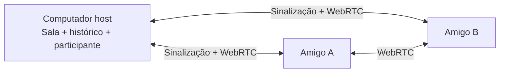

<div align="center">


# Voxy

### Converse. Mostre. Fique por perto.

Voz, chat e compartilhamento de tela para o seu grupo de amigos.<br />
Um aplicativo desktop para Windows, com mídia P2P e sala hospedada no seu computador.


[⬇ Baixar Voxy 0.5.0](https://github.com/labarro/Voxy/releases/download/v0.5.0/Voxy-Setup-0.5.0-x64.exe) · [Instalar e conectar](INSTALACAO-E-CONEXAO.md) · [Atualizar o Voxy](GUIA-DE-ATUALIZACAO.md) · [Desenvolvimento](#desenvolvimento) · [Documentação](#documentação)

</div>

---

## Em desenvolvimento: 0.6.0

Áudio avançado com teste privado, PTT por Mouse 4/5, reconexão ao canal de voz, menu compacto e volumes individuais até 200%, novos sons de transmissão e links clicáveis. [Guia de áudio e reconexão](AUDIO-E-CONEXAO.md). O instalador local fica em `release/0.6.0/Voxy-Setup-0.6.0-x64.exe`; esta versão ainda não foi publicada. O canal público e os downloads acima permanecem na 0.5.0.

## Novidades na versão 0.5.0

Presença Online/Ausente/Ocupado, DMs com histórico local e não lidas, servidores salvos na barra esquerda e navegação direta das novidades para os canais. As fotos dos servidores agora ocupam todo o botão. [Guia de conversas e status](CONVERSAS-E-STATUS.md).

A versão 0.5.0 está publicada no GitHub Releases e disponível pelo atualizador automático. Uma cópia do instalador publicado fica em `release/0.5.0/Voxy-Setup-0.5.0-x64.exe`. Para DMs e presença compartilhada, atualize o host e os participantes que usarão esses recursos.

## Sua sala, no seu computador

**Na versão 0.5.0:** webcam independente da tela, imagem do servidor administrada pelo criador, Home com servidores recentes, canal global de novidades e atualizações remotas assinadas. Atualize host e amigos para 0.5.0; versões até 0.3.0 não têm o novo contrato de mídia e não podem entrar nesta sala.

O Voxy reúne conversas e transmissões em servidores privados com canais de texto e voz. Um amigo hospeda a sala, compartilha um convite e os demais entram pela rede Radmin VPN. A mídia circula diretamente entre os participantes, usando WebRTC.

Sem VPS, banco hospedado ou assinatura do Voxy. O host guarda servidores e histórico; cada pessoa mantém seu perfil e suas preferências no próprio computador. A sala comporta **até dez participantes, incluindo quem hospeda**.

## O que você pode fazer

|                                   | Recursos                                                                                                                     |
| :-------------------------------- | :--------------------------------------------------------------------------------------------------------------------------- |
| 📹 **Usar sua webcam**            | Escolha a câmera, ligue ou desligue, veja os participantes e amplie em fullscreen, sem interromper a tela ou a voz.          |
| 🏠 **Voltar aos amigos**          | Home com servidores recentes persistentes, disponibilidade e reconexão com convite protegido no Windows.                     |
| 📰 **Acompanhar as versões**      | Canal global Novidades do Voxy, com data, funcionalidades, melhorias e correções, inclusive offline.                         |
| 🖥️ **Compartilhar a tela**        | Escolha um monitor ou janela, ajuste a qualidade e transmita enquanto conversa. Pare e reinicie sem sair da chamada.         |
| 🎙️ **Conversar por voz**          | Push-to-Talk com tecla configurável, mute, seleção de dispositivos, volume de entrada e filtro por sensibilidade.            |
| 🎧 **Controlar o que ouve**       | Volume salvo por participante, mute local pelo clique direito e volume independente para a transmissão.                      |
| ✉️ **Conversar em privado (0.5)** | DMs por sala com histórico local, imagens, edição/exclusão e mensagens não lidas.                                            |
| 🟢 **Definir presença (0.5)**     | Online, Ausente ou Ocupado, com preferência salva e sincronização entre participantes.                                       |
| 💬 **Trocar mensagens**           | Histórico persistente, edição e exclusão das próprias mensagens, imagens com prévia e ampliação.                             |
| 👤 **Usar seu perfil**            | Nome, foto do computador ou avatar em emoji — incluindo 👴.                                                                  |
| 🔴 **Acompanhar a chamada**       | Atividade de voz real, ícones de mute e áudio silenciado, selo **AO VIVO** e sons opcionais de entrada, saída e transmissão. |
| ⛶ **Assistir em fullscreen**      | Player sem bordas, ajuste de enquadramento e HUD que se oculta após 2,5 segundos de inatividade.                             |
| 📦 **Atualizar sem recomeçar**    | Busca e download automáticos, reinício escolhido pelo usuário, backup e novidades por versão.                                |

## Comece com seus amigos

### 1. Instale o Voxy

Baixe o instalador e o checksum na [release oficial 0.5.0](https://github.com/labarro/Voxy/releases/tag/v0.5.0), ou receba os mesmos arquivos de quem mantém o projeto:

```text
Voxy-Setup-0.5.0-x64.exe
SHA256SUMS.txt
```

Execute o instalador e conclua a instalação. **Os amigos não precisam instalar Node.js.** Todos devem usar a mesma versão para os recursos novos funcionarem corretamente.

O instalador gerado neste projeto fica em `release/0.5.0/Voxy-Setup-0.5.0-x64.exe`. Essa pasta é local e não é versionada no Git. O executável não tem assinatura digital; o Windows pode mostrar editor desconhecido. Confira a procedência e o SHA-256 do arquivo recebido.

### 2. Conecte a rede

Instalem o [Radmin VPN](https://www.radmin-vpn.com/) e entrem na mesma rede. Uma pessoa cria a rede; os amigos entram com o nome e a senha. Confirmem que todos aparecem online.

Não é necessário instalar Radmin Server ou Radmin Viewer. O convite do Voxy é uma autorização separada da senha da rede VPN.

### 3. Hospede e convide

1. Abra o Voxy e configure nome, foto ou emoji e dispositivos na engrenagem.
2. Clique em **Hospedar sala** e selecione seu endereço Radmin `26.x.x.x`.
3. Mantenha a porta `43120` ou escolha outra disponível.
4. Use **Copiar convite** e envie o texto aos amigos por um meio confiável.
5. Os amigos escolhem **Entrar em sala** e colam o convite completo.

```text
voxy://26.12.34.56:43120/<segredo-de-64-caracteres>
```

`127.0.0.1` serve apenas para testes no mesmo computador. O convite deve ser colado no Voxy; ele não abre o aplicativo automaticamente.

### 4. Entre na voz e compartilhe

Todos entram no mesmo canal de voz e permitem o microfone. O primeiro servidor já inclui `geral` e `Sala dos amigos`.

Para transmitir, use **Compartilhar tela**, selecione a fonte e a qualidade e inicie. Os amigos clicam em **Assistir à tela**. Fechar o player mantém a conversa; **Parar transmissão** encerra apenas o compartilhamento. O host também pode criar, renomear e excluir servidores e canais.

→ [Passo a passo completo de instalação e conexão](INSTALACAO-E-CONEXAO.md)

## Atualizações sem perder seus dados

A partir da 0.4.0 instalada, o Voxy consulta e baixa versões publicadas automaticamente, mostra o progresso e oferece **Reiniciar e atualizar**. O canal de distribuição já está publicado e validado.

Perfil, volumes, preferências e histórico ficam separados dos arquivos do programa. O fluxo iniciado pelo aplicativo cria um backup antes de executar o instalador. **Não é necessário desinstalar a versão anterior.**

O endpoint em **devbarros.com**, na Vercel, aponta para publicações do GitHub Releases. Os metadados são assinados com Ed25519 e o pacote é conferido antes da instalação. O download pode ser diferencial. Ao atualizar o host, a sala será encerrada temporariamente. Versões até 0.3.0 precisam receber a 0.5.0 uma última vez pelo instalador; o seletor manual permanece como alternativa.

→ [Guia para atualizar sem perder dados](GUIA-DE-ATUALIZACAO.md) · [Configurar domínio e publicação automática](ATUALIZACOES-REMOTAS.md)

## Áudio e tela do seu jeito

<details>
<summary><strong>Webcam, imagem do servidor e servidores recentes</strong></summary>

Dentro da chamada, clique em **Ativar câmera**, selecione o dispositivo e use **Ligar câmera selecionada**. **Trocar câmera** muda a fonte e **Desligar câmera** encerra a captura sem afetar voz ou tela. As webcams aparecem em uma grade; use **Ampliar câmera** para abrir o player com fullscreen e HUD por inatividade. A webcam não captura áudio: a conversa continua usando o microfone configurado. A câmera nunca é religada automaticamente após desconectar.

Em **Gerenciar servidor e canais**, o criador pode adicionar, alterar ou remover a imagem do servidor. Os demais podem visualizá-la. Servidores antigos sem criador registrado são atribuídos ao perfil do host na primeira abertura da sala após migrar.

**Home** mantém até 40 servidores recentes mesmo com o Radmin desligado, verifica disponibilidade ao abrir, voltar ao foco e a cada 30 segundos e permite atualizar a consulta manualmente. **Reconectar** usa o convite protegido no Windows; **Hospedar novamente** reabre sua própria sala quando o endereço salvo está disponível. Remover um recente apaga somente o acesso local. “Fora de alcance” não distingue host fechado, VPN desconectada e bloqueio de firewall. IP ou segredo alterado exige um novo convite.

**Novidades do Voxy**, no ícone de megafone da barra de servidores, fica disponível independentemente da sala. O histórico instalado é combinado com o catálogo remoto assinado e guardado em cache para consulta offline.

</details>

<details>
<summary><strong>Microfone, Push-to-Talk e sensibilidade</strong></summary>

Na engrenagem, ative o Push-to-Talk, clique em **alterar tecla**, pressione a tecla desejada e salve. Letras, números, F1–F24, modificadores, navegação, pontuação e teclado numérico são aceitos conforme o teclado Windows. É uma tecla individual, sem combinações; Fn e atalhos interceptados pelo sistema podem não funcionar. O mute manual tem prioridade. Se o leitor global falhar, o microfone permanece fechado nesse modo.

O **Volume de entrada** vai de 0 a 200%. Comece em 100% e use o medidor durante a chamada. Ative a **detecção de voz** e escolha um **Limite de ativação** acima do ruído ambiente e abaixo da sua voz. Mais perto de −70 dBFS é mais sensível; mais perto de −10 exige som forte.

O filtro mede intensidade, sem reconhecer fala: ruídos fortes também podem passar. A detecção vem desligada por padrão para preservar perfis antigos. O ganho automático do Chromium é solicitado como desativado; drivers e melhorias do Windows podem aplicar processamento próprio.

Alterações são aplicadas ao salvar. Nomes de dispositivos podem aparecer somente após permitir o microfone; a seleção de saída depende do suporte de `setSinkId`.

</details>

<details>
<summary><strong>Volumes, mute local e notificações</strong></summary>

O volume de cada voz fica no cartão e é salvo por perfil. Clique com o botão direito no cartão ou no nome da lateral e escolha **Mutar voz para mim**. **Ouvir voz novamente** restaura a voz no volume anterior. Os demais participantes não são afetados.

O áudio da transmissão tem volume e mute próprios no player. O fone cortado identifica quem silenciou a recepção da chamada; o volume cortado em âmbar mostra seu mute local. O mute do microfone desativa a track enviada; a atividade de voz é medida pelo áudio real.

Sons diferentes avisam entrada, saída e início de transmissão. Eles podem ser desligados nas configurações e respeitam o áudio silenciado.

</details>

<details>
<summary><strong>Qualidade, fullscreen e áudio do sistema</strong></summary>

| Qualidade      | Teto de bitrate por espectador |
| :------------- | -----------------------------: |
| 720p · 15 FPS  |                       1,8 Mbps |
| 720p · 30 FPS  |                         3 Mbps |
| 1080p · 30 FPS |                         5 Mbps |
| 1080p · 60 FPS |                         8 Mbps |

Resolução e FPS são objetivos, sujeitos à fonte, ao hardware e à conexão. Em uma sala com dez pessoas, transmitir a 5 Mbps para nove espectadores pode exigir aproximadamente **45 Mbps de upload**, além de áudio e overhead. A qualidade pode mudar durante a transmissão; o diagnóstico mostra os valores efetivos quando disponíveis.

No fullscreen, **Ajustar à janela** preserva a imagem inteira; **Preencher player** ocupa a área com recorte quando as proporções diferem. A HUD e o cursor somem após 2,5 segundos sem interação e reaparecem ao mover o mouse.

O áudio do sistema é opcional e vem desligado. No Windows, o loopback captura o sistema inteiro, mesmo ao compartilhar uma janela. Ele pode recapturar as vozes recebidas e causar eco; fones não eliminam essa recaptura digital. Se acontecer, desligue o áudio do sistema ou use roteamento externo. A reprodução audível entre máquinas ainda exige validação manual.

Cada pessoa pode transmitir e escolher qual tela assistir. Somente o áudio da tela selecionada é reproduzido; transmissões simultâneas de fontes diferentes ainda precisam de validação manual.

</details>

<details>
<summary><strong>Fotos de perfil, imagens e mensagens</strong></summary>

Use **Engrenagem → Escolher foto do computador** para selecionar PNG, JPEG ou WebP de até 5 MB, 8192 px por dimensão e 24 megapixels. O aplicativo faz um recorte central quadrado e reduz para 128×128. Salve para aplicar; escolha um emoji e salve para remover a foto. A miniatura é compartilhada com os membros da sala.

No chat, use **Enviar imagem** ou cole uma imagem PNG, JPEG ou WebP de até 2 MB, 8192 px por dimensão e 24 megapixels. Há prévia, remoção antes de enviar e ampliação. As imagens ficam no banco do host e são carregadas conforme aparecem no histórico.

Suas mensagens oferecem **Editar** e **Excluir**, com confirmação de exclusão e indicação de edição. Editar a legenda preserva a imagem; excluir a mensagem remove também o anexo.

</details>

## Como funciona



O exemplo mostra três computadores na mesma rede privada; o limite é dez. **Socket.IO** sincroniza a sala e troca a sinalização. **WebRTC mesh** envia voz e tela entre os participantes do mesmo canal. O host também participa da chamada, mas não retransmite a mídia dos outros.

| Camada                  | Tecnologia                                          |
| :---------------------- | :-------------------------------------------------- |
| Desktop                 | Electron                                            |
| Interface               | React, TypeScript, Vite, Tailwind CSS e Lucide      |
| Comunicação             | WebRTC nativo e Socket.IO                           |
| Persistência            | SQLite com sql.js/WASM                              |
| Rede entre computadores | Radmin VPN ou LAN privada acessível                 |
| Distribuição            | electron-builder e instalador NSIS para Windows x64 |

## Desenvolvimento

Requisitos: **Windows x64, Node.js 24 LTS e npm**. As versões resolvidas das dependências estão no lockfile.

```powershell
git clone https://github.com/labarro/Voxy.git
cd Voxy
npm ci
npm run dev
```

O comando inicia Vite em `127.0.0.1:5173` e abre o Electron. O renderer tem atualização automática; mudanças no main ou preload exigem reiniciar o comando. A ponte de desktop é necessária, portanto abrir apenas o Vite no navegador não executa o aplicativo completo.

| Comando         | O que faz                                       |
| :-------------- | :---------------------------------------------- |
| `npm run dev`   | Executa o ambiente de desenvolvimento.          |
| `npm run build` | Verifica TypeScript e gera o build de produção. |
| `npm start`     | Abre o último build no Electron.                |
| `npm run dist`  | Gera o instalador Windows x64 e seu SHA-256.    |
| `npm run pack`  | Gera a pasta do executável sem instalador.      |

Cada empacotamento usa uma pasta `build-*` nova. `release/0.5.0/latest-build.json` indica a pasta final; para distribuir sem instalador, copie a pasta `win-unpacked` inteira. O ícone original pode ser reproduzido com `node scripts/icon.mjs`.

[`.env.example`](.env.example) documenta a variável opcional `VOXY_DATA_DIR`. O aplicativo não carrega `.env` automaticamente. Para publicar atualizações, configure o segredo de assinatura descrito em [ATUALIZACOES-REMOTAS.md](ATUALIZACOES-REMOTAS.md); clientes não precisam de credenciais.

### Testes e validação

| Comando                   | Cobertura                                                                                     |
| :------------------------ | :-------------------------------------------------------------------------------------------- |
| `npm test`                | Contratos, persistência, autorização, migrações e atualizações.                               |
| `npm run test:microphone` | Ganho e detecção com Web Audio real e fonte de teste.                                         |
| `npm run test:ptt`        | Pressionar e soltar teclas globais no Windows.                                                |
| `npm run test:ux`         | Navegação, presença, DMs isoladas, notificações, leitura e reconexão offline em três janelas. |
| `npm run test:media`      | Mesh de dez clientes, áudio, vídeo e reconexões.                                              |
| `npm run test:desktop`    | Integração com três janelas Electron e captura nativa.                                        |
| `npm run test:dev`        | Vite, React Refresh e preload.                                                                |
| `npm run test:packaged`   | Executável empacotado após `npm run dist`, com persistência entre reinícios.                  |

Os testes de navegador usam Microsoft Edge instalado. `test:desktop` utiliza microfone e captura de desktop reais, com perfis isolados em `test-results/`; execute em um desktop de teste sem conteúdo sensível aberto. Fontes sintéticas são usadas somente nos testes.

**Validado na linha 0.4:** 18 testes de serviço/contratos, 45 pares WebRTC, áudio nos 90 sentidos e vídeo para nove espectadores em dois ciclos. Captura nativa e interface foram verificadas com três instâncias Electron locais; o executável empacotado foi aberto duas vezes para verificar persistência e novidades.

A release 0.5.0 foi gerada e publicada pelo GitHub Actions. O fluxo público pelo domínio chegou ao estado pronto para instalar, com catálogo e pacote verificados, sem executar a instalação.

**Validação ainda pendente:** dez computadores físicos pelo Radmin, avaliação humana de áudio em ambiente ruidoso, desempenho prolongado, atalhos com programas elevados e instalação NSIS sobre uma instalação pessoal existente.

→ [Resultados, evidências e roteiro de testes manuais](TESTING.md)

## Conexão, dados e limites

<details>
<summary><strong>Radmin, firewall e diagnóstico</strong></summary>

Hospede exclusivamente no IP Radmin quando for conectar pela VPN. O Voxy prioriza endereços `26.x.x.x` de adaptadores com Radmin no nome; se o adaptador foi renomeado, restaure um nome contendo Radmin e confira o IP. A faixa 26/8 é uma exceção específica da VPN, não uma faixa privada RFC1918.

A sinalização usa TCP na porta escolhida e apenas no endereço de escuta. WebRTC usa portas UDP locais dinâmicas. Radmin e Firewall do Windows precisam permitir esses fluxos entre os amigos. Não abra portas no roteador nem exponha o host publicamente. Restrinja as permissões ao executável, à interface Radmin e aos IPs do grupo; em desenvolvimento, o executável é `node_modules/electron/dist/electron.exe`.

Use `ping IP_RADMIN_DO_AMIGO` para investigar a rede e `Test-NetConnection IP_RADMIN_DO_HOST -Port 43120` para verificar a sinalização TCP. Ping bloqueado pode ser uma restrição de ICMP; TCP acessível não garante que a mídia funcione.

O botão de rede do Voxy mostra conexão, ICE, signaling, codec, bitrate, resolução/FPS, perdas e RTT quando o Chromium os fornece. Após perder a sessão, entre novamente na voz; microfone e tela não são reabertos silenciosamente.

O MVP exige convite com IPv4 e segredo; não aceita endereço sem segredo, DNS ou IPv6. Consulte também o [suporte oficial do Radmin VPN](https://www.radmin-vpn.com/help/index.html).

</details>

<details>
<summary><strong>Onde ficam os dados e como fazer backup</strong></summary>

Os dados ficam em `%APPDATA%\voxy-desktop`, separados da instalação:

| Arquivo                | Conteúdo                                                              |
| :--------------------- | :-------------------------------------------------------------------- |
| `room.sqlite`          | Servidores, canais, mensagens e imagens do host.                      |
| `direct-inbox.json`    | Histórico local e marcadores de leitura de conversas privadas.        |
| `profile-identity.bin` | Identidade do dispositivo protegida pelo Windows; incluída no backup. |
| `profile.json`         | Perfil e preferências locais.                                         |
| `host-secret.bin`      | Segredo do convite protegido pelo armazenamento seguro do Windows.    |
| `diagnostics.log`      | Logs de conexão sem convites, tokens, SDP ou conteúdo de mensagens.   |

`VOXY_DATA_DIR` pode substituir a pasta durante testes. Não use duas instâncias no mesmo perfil. Para backup manual, feche o aplicativo e copie a pasta de dados; histórico e perfil não são criptografados. O fluxo de atualização pelo aplicativo também cria backup antes de instalar.

O host recupera os servidores ao hospedar novamente. Clientes mantêm perfil e dispositivos e salvam convites dos servidores recentes com proteção do Windows. Se um convite vazar, feche o host, remova apenas `host-secret.bin` e hospede novamente para gerar outro segredo. Preserve `room.sqlite` para manter o histórico.

</details>

### Limites que vale conhecer

- **O host precisa permanecer aberto.** Fechá-lo encerra a sala; não há migração automática para outro computador.
- **A conectividade depende da rede.** Não há STUN/TURN ou relay de mídia no aplicativo. Sem caminho ICE entre os pares, a chamada pode falhar.
- **DMs dependem do host.** O texto fica em cache offline; anexos e novos envios precisam de conexão à sala. O host pode ler as mensagens, e não há criptografia ponta a ponta. Veja [privacidade e identidade](CONVERSAS-E-STATUS.md).
- **O convite dá acesso à sala.** Compartilhe-o apenas com pessoas confiáveis. Nome e avatar não são identidades verificadas; não há conta individual ou expulsão por usuário.
- **O histórico pertence ao host.** Clientes não mantêm uma réplica persistente. A interface carrega as últimas 500 mensagens por canal; as anteriores permanecem no SQLite, sem paginação.
- **Windows 10/11 x64 são os alvos.** A execução foi validada no Windows build 26200, sem teste em uma instalação limpa de Windows 10.

Não há bots, sincronização offline, anexos de outros formatos ou assinatura de código. Consulte [arquitetura e segurança](ARCHITECTURE.md) para os detalhes.

## Documentação

| Guia                                            | Conteúdo                                                            |
| :---------------------------------------------- | :------------------------------------------------------------------ |
| [Instalação e conexão](INSTALACAO-E-CONEXAO.md) | Arquivos para enviar aos amigos, Radmin e primeira chamada.         |
| [Publicação remota](ATUALIZACOES-REMOTAS.md)    | Domínio Vercel, GitHub Actions, assinatura e download diferencial.  |
| [Atualizações](GUIA-DE-ATUALIZACAO.md)          | Atualizar sem desinstalar, backups e distribuição de novas versões. |
| [Arquitetura](ARCHITECTURE.md)                  | Host local, WebRTC mesh, persistência e segurança.                  |
| [Testes](TESTING.md)                            | Verificações executadas, evidências e validações pendentes.         |
| [Análise de interface](ANALYSIS.md)             | Análise com REA, decisões de experiência e limites de acesso.       |

---

<div align="center">
  <sub>Voxy · Uma sala para conversar, mostrar e ficar por perto.</sub>
</div>
